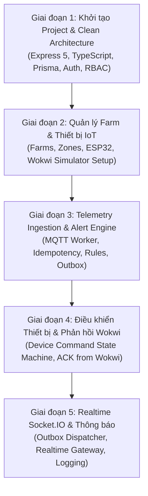

# KẾ HOẠCH TRIỂN KHAI TINH CHỈNH – BACKEND SMART AGRICULTURE
**Dự án**: Smart Agriculture System (Node.js Express Core, Supabase PostgreSQL, MQTT & Wokwi Simulator)  
**Tài liệu thiết kế**: [thietke.md](file:///e:/Du%20An/Smart%20Agriculture/docs/thietke.md)  
**Phạm vi cập nhật theo yêu cầu người dùng**:
1. **Không phụ thuộc .NET cũ**: Bỏ qua Phase 0 (Audit .NET). Xây dựng chuẩn theo thiết kế mới.
2. **Database hoàn toàn mới**: Khởi tạo schema mới trên Supabase PostgreSQL từ Prisma.
3. **Thiết bị IoT**: Giả lập ESP32 bằng **Wokwi** (kết nối trực tiếp EMQX Broker, gửi telemetry và nhận command).
4. **AI**: Tạm thời gác lại (Deferred) để tập trung tối đa vào luồng Core IoT, Telemetry, Cảnh báo, Điều khiển và Realtime.

---

## 1. LỘ TRÌNH TRIỂN KHAI RÚT GỌN (5 GIAI ĐOẠN TRỌNG TÂM)

---

### GIAI ĐOẠN 1: KHỞI TẠO NỀN TẢNG KIẾN TRÚC & IDENTITY
- **Task 1.1**: Khởi tạo Node.js project tại `backend/`:
  - TypeScript 5, Express 5, Prisma ORM, Zod, Pino logger, CORS, Dotenv.
  - Cấu trúc thư mục Clean Architecture (`domain`, `application`, `infrastructure`, `presentation`).
- **Task 1.2**: Prisma Schema & Migration (Database mới trên Supabase):
  - Bảng `users`, `roles`, `permissions`, `user_roles`, `role_permissions`.
  - Seed dữ liệu mặc định: Super Admin, các quyền và vai trò chuẩn.
- **Task 1.3**: Module Authentication & Phân quyền:
  - Đăng ký, Đăng nhập, Refresh Token, Đổi mật khẩu.
  - JWT Access Token + Refresh Token (kèm cơ chế rotation).
  - Middleware xác thực Token & phân quyền (Global RBAC + Farm-scoped RBAC).

---

### GIAI ĐOẠN 2: QUẢN LÝ NÔNG TRẠI & BỘ GIẢ LẬP IOT (WOKWI)
- **Task 2.1**: Module Farm & Phân vùng (Farms & Zones):
  - CRUD Nông trại (tọa độ, vị trí, chủ nông trại, thành viên).
  - CRUD Khu vực (Zones) trong từng nông trại.
- **Task 2.2**: Module Thiết bị & Cảm biến (Devices & Sensors):
  - Đăng ký thiết bị ESP32 (`device_code`, zone, loại thiết bị, firmware).
  - Quản lý các loại cảm biến gắn kèm (DHT22: nhiệt độ/độ ẩm, cảm biến độ ẩm đất, ánh sáng).
  - Cơ chế Device Credential (mật khẩu kết nối MQTT mã hóa).
- **Task 2.3**: Xây dựng kịch bản giả lập Wokwi ESP32:
  - Tạo source code ESP32 Arduino/C++ cho Wokwi (`wokwi/diagram.json` và `sketch.ino`).
  - Cấu hình Wokwi kết nối EMQX MQTT Broker (`broker.emqx.io`).
  - Mô phỏng định kỳ đọc cảm biến DHT22 + Soil Moisture và publish dữ liệu lên topic `smartagri/devices/{deviceCode}/telemetry`.
  - Lắng nghe topic điều khiển `smartagri/devices/{deviceCode}/commands` (bật/tắt LED/Relay tượng trưng cho máy bơm/quạt) và gửi trả ACK.

---

### GIAI ĐOẠN 3: TIẾP NHẬN DỮ LIỆU TELEMETRY & ĐỘNG CƠ CẢNH BÁO
- **Task 3.1**: MQTT Client Connection Infrastructure:
  - Kết nối broker EMQX thông qua thư viện `mqtt.js`.
  - Cơ chế tự động kết nối lại (auto-reconnect), xử lý mất mạng an toàn.
- **Task 3.2**: Tiến trình MQTT Ingestion Worker (`backend/workers/mqtt-ingestion`):
  - Subscribe topic `smartagri/devices/+/telemetry`.
  - Validate định dạng payload bằng Zod.
  - Kiểm tra tính trùng lặp (`messageId` idempotency).
- **Task 3.3**: Động cơ Cảnh báo (Alert Rule Engine):
  - Cấu hình ngưỡng cảnh báo theo Metric (`GT`, `LT`, `RANGE`).
  - Cơ chế chống bão cảnh báo (Alert Deduplication Key + Cooldown).
  - Cập nhật trạng thái thiết bị `ONLINE` và `last_seen_at`.
- **Task 3.4**: Transactional Outbox:
  - Ghi đồng thời bản ghi `telemetry`, `alerts` và `outbox_events` trong cùng một PostgreSQL Transaction để chống mất mát dữ liệu.
- **Task 3.5**: REST API truy vấn dữ liệu Telemetry & Alerts:
  - Lấy telemetry mới nhất, lịch sử theo thời gian vẽ biểu đồ.
  - Danh sách cảnh báo, xác nhận cảnh báo (`acknowledge`), giải quyết (`resolve`).

---

### GIAI ĐOẠN 4: ĐIỀU KHIỂN THIẾT BỊ 2 CHIỀU (COMMAND STATE MACHINE)
- **Task 4.1**: State Machine 6 bước cho lệnh điều khiển:
  - `ACCEPTED` -> `PUBLISHED` -> `ACKNOWLEDGED` -> `EXECUTED` / `FAILED` / `TIMEOUT`.
- **Task 4.2**: REST API gửi lệnh điều khiển (`POST /devices/:id/commands`):
  - Validate quyền, tạo bản ghi `device_commands` và đẩy sự kiện vào Outbox.
- **Task 4.3**: MQTT Command Dispatcher:
  - Lấy lệnh từ Outbox và publish xuống topic `smartagri/devices/{deviceCode}/commands`.
- **Task 4.4**: Xử lý ACK từ Wokwi ESP32:
  - Ingestion Worker lắng nghe `smartagri/devices/{deviceCode}/ack` từ Wokwi và cập nhật trạng thái lệnh sang `ACKNOWLEDGED` / `EXECUTED`.

---

### GIAI ĐOẠN 5: REALTIME SOCKET.IO & OUTBOX DISPATCHER
- **Task 5.1**: Outbox Dispatcher Worker:
  - Polling bảng `outbox_events` với `FOR UPDATE SKIP LOCKED`.
  - Xử lý retry có giới hạn (exponential backoff).
- **Task 5.2**: Socket.IO Gateway:
  - Xác thực JWT cho client Web/Mobile.
  - Phân chia rooms: `farm:{farmId}`, `zone:{zoneId}`, `device:{deviceId}`.
  - Phát các sự kiện realtime:
    - `telemetry:new` (dữ liệu cảm biến mới từ Wokwi).
    - `device:status` (thiết bị online/offline).
    - `alert:new` / `alert:updated` (cảnh báo vi phạm ngưỡng).
    - `command:status` (tiến độ thực thi lệnh bơm/quạt).
- **Task 5.3**: Health Check & Tài liệu API Swagger:
  - Endpoint `/health`.
  - Swagger UI tại `/api-docs`.
