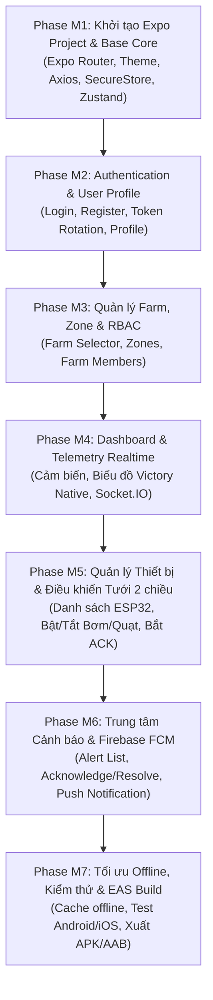

# KẾ HOẠCH TRIỂN KHAI XÂY DỰNG MOBILE APP – FARM HOME
**Dự án**: Farm Home Mobile Application (Smart Agriculture Ecosystem)  
**Tài liệu tham chiếu**: [thietkesmobile.md](file:///e:/Du%20An/Smart%20Agriculture/docs/thietkesmobile.md) & [thietke.md](file:///e:/Du%20An/Smart%20Agriculture/docs/thietke.md)  
**Công nghệ nền tảng**: React Native + Expo + TypeScript + Expo Router  
**Mục tiêu**: Xây dựng ứng dụng di động hoàn chỉnh phục vụ người nông dân và kỹ thuật viên giám sát môi trường, điều khiển tưới tiêu 2 chiều, nhận cảnh báo thời gian thực và quản lý nông trại.

---

## 1. NGUYÊN TẮC THIẾT KẾ & KIẾN TRÚC ỨNG DỤNG

### 1.1. Các nguyên tắc kỹ thuật cốt lõi
1. **Kiến trúc Clean Architecture & Feature-based**: Phân tách rõ ràng giữa `presentation` (UI Screens, Components, ViewModels), `domain` (Entities, Use Cases) và `data` (API Client, DTOs, Mappers, Repositories). Component giao diện không được gọi API trực tiếp.
2. **Không kết nối trực tiếp cơ sở dữ liệu hay MQTT**: Mọi luồng dữ liệu đều đi qua Backend Node.js Express Core (`http://localhost:5001/api/v1`). Backend chịu trách nhiệm xác thực JWT, RBAC, giao tiếp MQTT với ESP32, Outbox và FCM.
3. **Phân tầng State Management rõ ràng**:
   - **Server State**: Quản lý bằng **TanStack Query** (caching, re-fetching, phân trang, optimistic updates).
   - **Client State**: Quản lý bằng **Zustand** (trạng thái người dùng, nông trại đang chọn `selectedFarm`, khu vực đang chọn `selectedZone`, theme).
   - **Bảo mật cục bộ**: Lưu trữ Access/Refresh Token bằng **Expo SecureStore**.
   - **Realtime**: Kết nối WebSocket qua **Socket.IO Client** nhận sự kiện trực tiếp từ server.
4. **An toàn điều khiển thiết bị (Safe Actuation)**:
   - Mọi thao tác bật máy bơm/quạt bắt buộc có hộp thoại xác nhận.
   - Thể hiện trạng thái lệnh minh bạch theo State Machine: `Đang tiếp nhận (ACCEPTED)` → `Đang gửi xuống thiết bị (PUBLISHED)` → `Thiết bị đã nhận (ACKNOWLEDGED)` → `Thực thi thành công (EXECUTED)`. Tuyệt đối không báo thành công ngay khi vừa bấm nút.

---

## 2. LỘ TRÌNH TRIỂN KHAI 7 GIAI ĐOẠN (PHASE M1 – PHASE M7)

---

### GIAI ĐOẠN M1: KHỞI TẠO DỰ ÁN & NỀN TẢNG CORE (FOUNDATION)
> **Mục tiêu**: Thiết lập bộ khung ứng dụng React Native với Expo SDK mới nhất, TypeScript, Expo Router và các tiện ích cốt lõi.

- [ ] **Task M1.1: Khởi tạo Expo Project tại `mobile/`**:
  - Khởi tạo Expo với TypeScript template và Expo Router (`app/` directory).
  - Cài đặt các thư viện lõi: `react-native-paper`, `react-native-safe-area-context`, `react-native-screens`, `lucide-react-native` (hoặc `@expo/vector-icons`).
- [ ] **Task M1.2: Cấu hình Theme & Design Tokens**:
  - Xây dựng bảng màu phong cách nông nghiệp hiện đại: Xanh lá chủ đạo (`#2E7D32`, `#4CAF50`), xanh lá đậm (`#1B5E20`), nền xám nhẹ (`#F8FAF8`), thẻ bo góc 16px.
  - Cấu hình font chữ, typography, spacing và component Card/Button dùng chung.
- [ ] **Task M1.3: Cấu hình Network Client & Token Storage**:
  - Tạo `src/core/api/api-client.ts` sử dụng Axios:
    - Base URL trỏ về Backend (`http://<LAN_IP>:5001/api/v1` cho máy thật / `http://10.0.2.2:5001/api/v1` cho Android Emulator).
    - Request Interceptor: Tự động đính kèm `Authorization: Bearer <accessToken>` từ `SecureStore`.
    - Response Interceptor: Tự động bắt lỗi `401 Unauthorized`, gọi endpoint `/auth/refresh-token` để lấy Access Token mới và thử lại request cũ (Auto Refresh Token).
- [ ] **Task M1.4: Cấu hình State Management**:
  - Cài đặt `@tanstack/react-query` và bọc `QueryClientProvider` tại `app/_layout.tsx`.
  - Cài đặt `zustand` tạo `useAuthStore` (lưu trạng thái login, user profile) và `useFarmStore` (lưu `selectedFarmId`, `selectedZoneId`).
- [ ] **Task M1.5: Bộ khung Navigation (Expo Router)**:
  - Cấu trúc thư mục định tuyến `app/`:
    - `app/_layout.tsx`: Root layout (Theme, QueryClient, Auth Guard).
    - `app/(auth)/_layout.tsx`: Nhóm màn hình đăng nhập, đăng ký, quên mật khẩu.
    - `app/(tabs)/_layout.tsx`: Bottom Tab Bar 5 tabs (Tổng quan, Trang trại, Thiết bị, Cảnh báo, Tài khoản).

---

### GIAI ĐOẠN M2: AUTHENTICATION & HỒ SƠ CÁ NHÂN (PHASE M2)
> **Mục tiêu**: Xây dựng luồng xác thực hoàn chỉnh, bảo mật token và quản lý phiên làm việc.

- [ ] **Task M2.1: Màn hình Đăng nhập (`app/(auth)/login.tsx`)**:
  - Form đăng nhập (Email, Mật khẩu, Nút ẩn/hiện mật khẩu) sử dụng `react-hook-form` + `zod`.
  - Gọi API `POST /api/v1/auth/login`.
  - Lưu cặp `accessToken` & `refreshToken` vào `Expo SecureStore`.
  - Lưu thông tin người dùng vào `useAuthStore` và điều hướng vào màn hình chính `(tabs)`.
- [ ] **Task M2.2: Màn hình Đăng ký & Quên mật khẩu**:
  - `app/(auth)/register.tsx`: Đăng ký tài khoản mới (`POST /api/v1/auth/register`).
  - `app/(auth)/forgot-password.tsx` & `reset-password.tsx`: Luồng khôi phục mật khẩu.
- [ ] **Task M2.3: Màn hình Tài khoản (`app/(tabs)/profile.tsx`)**:
  - Hiển thị thông tin cá nhân, vai trò toàn hệ thống (Global Role) và danh sách nông trại trực thuộc.
  - Chức năng Đổi mật khẩu (`POST /api/v1/auth/change-password`).
  - Chức năng Đăng xuất: Xóa token trong SecureStore, gọi API `POST /api/v1/auth/logout` và chuyển hướng về màn hình Login.

---

### GIAI ĐOẠN M3: QUẢN TRỊ NÔNG TRẠI & PHÂN VÙNG (PHASE M3)
> **Mục tiêu**: Quản lý nhiều nông trại (Multi-farm), phân chia khu vực canh tác (Zone) và phân quyền nhân sự.

- [ ] **Task M3.1: Component Farm Selector trên Header**:
  - Dropdown chọn nông trại hiển thị ở Header của Dashboard.
  - Cho phép người dùng chuyển đổi qua lại giữa các nông trại mà mình có quyền. Lưu nông trại đang chọn vào `useFarmStore`.
- [ ] **Task M3.2: Màn hình Danh sách Nông trại (`app/(tabs)/farms.tsx`)**:
  - Truy vấn `GET /api/v1/farms` bằng TanStack Query.
  - Hiển thị danh sách nông trại dạng thẻ Card trực quan: tên nông trại, vị trí, diện tích, số lượng khu vực và thiết bị.
  - Màn hình Tạo/Sửa Nông trại (`app/farms/create.tsx`, `edit.tsx`).
- [ ] **Task M3.3: Quản lý Khu vực Canh tác (Zones)**:
  - Màn hình Chi tiết Nông trại & danh sách Zones (`app/farms/[id].tsx`).
  - Tạo mới và cập nhật thông tin Zone (diện tích, mô tả, loại cây trồng).
- [ ] **Task M3.4: Quản lý Thành viên Nông trại**:
  - Hiển thị danh sách nhân sự thuộc Farm kèm vai trò (`FARM_MANAGER`, `TECHNICIAN`, `FARM_WORKER`, `VIEWER`).
  - Chức năng thêm thành viên và đổi vai trò (dành cho chủ nông trại `FARM_OWNER`).

---

### GIAI ĐOẠN M4: DASHBOARD & GIÁM SÁT CẢM BIẾN REALTIME (PHASE M4)
> **Mục tiêu**: Màn hình trung tâm hiển thị chỉ số vi khí hậu, vẽ biểu đồ theo thời gian và cập nhật trực tiếp qua Socket.IO.

- [ ] **Task M4.1: Màn hình Tổng quan Dashboard (`app/(tabs)/index.tsx`)**:
  - Header: Lời chào người dùng, Farm Selector, nút chuông thông báo có badge đếm số lượng chưa đọc.
  - Thẻ tóm tắt thiết bị: Số thiết bị đang hoạt động (`ONLINE / OFFLINE`).
  - Các khối chỉ số môi trường chính:
    - 🌡️ **Nhiệt độ không khí** (kèm màu cảnh báo nếu > 35°C).
    - 💧 **Độ ẩm không khí** (%).
    - 🌱 **Độ ẩm đất** (%).
    - ☀️ **Cường độ ánh sáng** / Mực nước.
- [ ] **Task M4.2: Biểu đồ Diễn biến Môi trường (Charts)**:
  - Tích hợp thư viện biểu đồ (`react-native-chart-kit` hoặc `victory-native`).
  - Bộ lọc khoảng thời gian: `1 giờ`, `24 giờ`, `7 ngày`.
  - Gọi API `GET /api/v1/telemetry/history` để vẽ đường biến thiên nhiệt độ và độ ẩm đất.
- [ ] **Task M4.3: Tích hợp Realtime Socket.IO**:
  - Tạo kết nối Socket.IO tới Backend tại `src/core/realtime/socket-client.ts`.
  - Tham gia phòng theo farm: `socket.emit('join:room', 'farm:' + selectedFarmId)`.
  - Lắng nghe sự kiện `telemetry:new`: Cập nhật trực tiếp số liệu trên Dashboard và thêm điểm mới vào biểu đồ mà không cần load lại trang.

---

### GIAI ĐOẠN M5: QUẢN LÝ THIẾT BỊ IOT & ĐIỀU KHIỂN TƯỚI 2 CHIỀU (PHASE M5)
> **Mục tiêu**: Theo dõi thiết bị ESP32, kiểm soát trạng thái phần cứng và gửi lệnh điều khiển máy bơm/quạt với phản hồi ACK minh bạch.

- [ ] **Task M5.1: Màn hình Danh sách Thiết bị (`app/(tabs)/devices.tsx`)**:
  - Hiển thị danh sách ESP32 nhóm theo từng Khu vực (Zone).
  - Trạng thái trực quan: Chấm xanh (`ONLINE`), chấm đỏ (`OFFLINE`), hiển thị thời gian gửi tin cuối cùng (`Last seen`).
  - Chi tiết thiết bị (`app/devices/[id].tsx`): Thông tin vi điều khiển, phiên bản firmware, danh sách cảm biến gắn kèm.
- [ ] **Task M5.2: Giao diện Điều khiển Thiết bị (Actuator Controls)**:
  - Thẻ điều khiển Máy bơm nước (Water Pump) và Quạt làm mát (Cooling Fan).
  - Công tắc bật/tắt (Switch / Button) kèm tùy chọn thời gian chạy (ví dụ: Bật 60 giây, 120 giây).
  - Hộp thoại cảnh báo an toàn: *"Bạn có chắc chắn muốn bật máy bơm khu vực Nhà kính 01 trong 60 giây?"*.
- [ ] **Task M5.3: Luồng Xử lý Lệnh & Phản hồi Trạng thái**:
  - Gửi lệnh qua API `POST /api/v1/devices/{id}/commands` kèm `idempotencyKey` chống bấm đúp.
  - Hiển thị Toast hoặc Banner trạng thái:
    - 🟡 **Đang tiếp nhận... (ACCEPTED)**
    - 🔵 **Đang gửi lệnh xuống ESP32... (PUBLISHED)**
    - 🟢 **Thiết bị đã bật thành công! (EXECUTED)** (nhận ACK qua Socket.IO `command:status`).
    - 🔴 **Lệnh thất bại hoặc quá thời gian chờ (TIMEOUT)**.

---

### GIAI ĐOẠN M6: TRUNG TÂM CẢNH BÁO & FIREBASE PUSH NOTIFICATION (PHASE M6)
> **Mục tiêu**: Tiếp nhận và xử lý cảnh báo tức thì, nhận thông báo đẩy khi đóng ứng dụng.

- [ ] **Task M6.1: Màn hình Cảnh báo (`app/(tabs)/alerts.tsx`)**:
  - Danh sách cảnh báo phân cấp theo mức độ nghiêm trọng: `CRITICAL` (đỏ), `WARNING` (vàng), `INFO` (xanh).
  - Bộ lọc: Cảnh báo đang hoạt động (`ACTIVE`), Đã xác nhận (`ACKNOWLEDGED`), Đã xử lý (`RESOLVED`).
  - Nút thao tác nhanh: **Xác nhận (Acknowledge)** và **Giải quyết (Resolve)** gọi API tương ứng.
- [ ] **Task M6.2: Tích hợp Thông báo đẩy (Firebase FCM & Expo Notifications)**:
  - Cấu hình `expo-notifications` xin quyền thông báo khi người dùng đăng nhập.
  - Lấy FCM Device Token và gửi lên Backend qua `POST /api/v1/notifications/device-tokens`.
  - Xử lý khi nhận Notification:
    - Ứng dụng đang mở (Foreground): Hiển thị In-app Notification Banner kèm âm thanh.
    - Ứng dụng chạy nền / Đóng (Background): Chạm vào thông báo sẽ mở ứng dụng và điều hướng thẳng đến chi tiết cảnh báo (`app/alerts/[id].tsx`).

---

### GIAI ĐOẠN M7: TỐI ƯU OFFLINE, KIỂM THỬ & ĐÓNG GÓI BUILD (PHASE M7)
> **Mục tiêu**: Đảm bảo trải nghiệm mượt mà, kiểm thử đa thiết bị và xuất file cài đặt Android/iOS.

- [ ] **Task M7.1: Tối ưu Caching & Xử lý Mất kết nối (Offline Support)**:
  - Tận dụng cache của TanStack Query để người dùng vẫn xem được dữ liệu gần nhất khi mất 4G/WiFi ngoài ruộng.
  - Hiển thị thanh thông báo trạng thái mạng khi mất kết nối.
- [ ] **Task M7.2: Kiểm thử Toàn diện (Testing)**:
  - Kiểm thử tương thích trên cả Android (màn hình nhỏ/lớn) và iOS.
  - Kiểm thử chu trình: Bật mô phỏng trên Wokwi → Xem số liệu trên App → Bấm bật máy bơm trên App → Đèn LED trên Wokwi sáng lên → App nhận thông báo EXECUTED.
- [ ] **Task M7.3: Cấu hình EAS Build & Xuất bản**:
  - Tạo `app.json` cấu hình tên ứng dụng, icon, splash screen chuẩn.
  - Cấu hình `eas.json` để build file APK cài đặt trực tiếp trên điện thoại Android thử nghiệm.

---

## 3. BẢNG TIẾN ĐỘ & ƯỚC LƯỢNG NỖ LỰC (ESTIMATION)

| Giai đoạn | Hạng mục công việc chính | Thời gian dự kiến | Đầu ra bàn giao |
|---|---|:---:|---|
| **Phase M1** | Setup Expo, TypeScript, Theme, Axios, SecureStore | 3 - 4 ngày | Khung app chạy được, Navigation Tab Bar |
| **Phase M2** | Auth Flow, Login, Register, Profile, Token Refresh | 4 - 5 ngày | Đăng nhập/Đăng xuất hoàn chỉnh |
| **Phase M3** | Farm Selector, Farm & Zone Management, Members | 4 - 5 ngày | Quản lý Farm/Zone/Thành viên |
| **Phase M4** | Dashboard, Thẻ chỉ số cảm biến, Biểu đồ, Socket.IO | 5 - 7 ngày | Giám sát realtime từ Wokwi ESP32 |
| **Phase M5** | Quản lý thiết bị, Điều khiển bơm/quạt, Luồng ACK | 5 - 7 ngày | Điều khiển thiết bị 2 chiều an toàn |
| **Phase M6** | Alert Center, Xử lý cảnh báo, Firebase FCM Push | 4 - 5 ngày | Nhận thông báo đẩy khi đóng app |
| **Phase M7** | Tối ưu Offline, Test Android/iOS, Xuất file APK | 4 - 5 ngày | File cài đặt APK chạy thực tế |
| **TỔNG CỘNG** | **Toàn bộ ứng dụng di động Farm Home** | **~4 - 5 tuần** | **Ứng dụng hoàn thiện sẵn sàng phát hành** |

---

## 4. BƯỚC HÀNH ĐỘNG TIẾP THEO

Tôi đã sẵn sàng khởi tạo thư mục `mobile/` với cấu trúc **Expo Router + TypeScript + React Native Paper + TanStack Query + Zustand**. 

Anh/chị có muốn bắt đầu triển khai ngay **Giai đoạn M1 (Khởi tạo dự án & Bộ khung Navigation 5 Tabs)** không?

